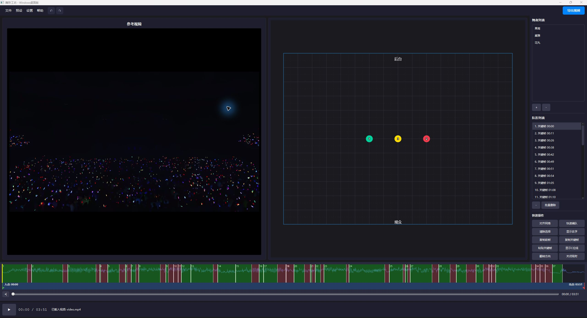
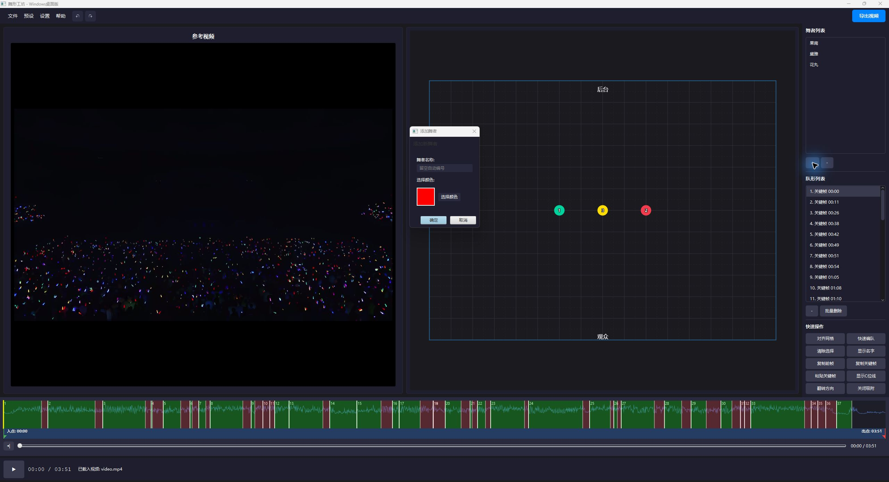
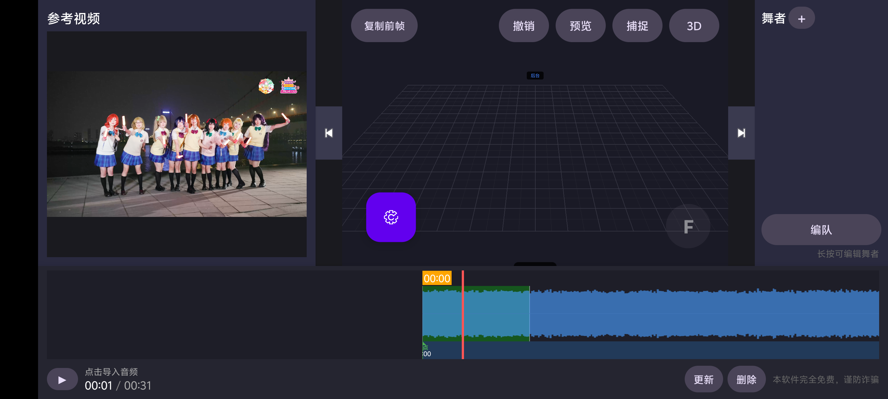
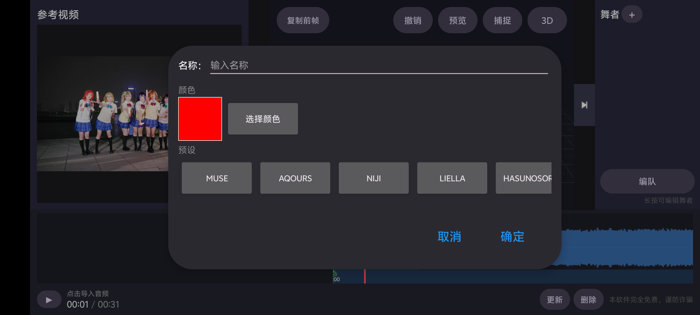

# DanceFactory / 舞形工坊

DanceFactory（舞形工坊）是一款**免费、开源、跨平台**的舞台队形编排工具。它主要为以下用户开发：

- LoveLive! 等偶像企划的翻跳团、舞见团体和 Coser 团体；
- 需要提前设计站位与换位节奏的舞团、校园舞社和唱跳组合；
- 负责排练统筹、走位记录和演出沟通的编舞、队长与舞台负责人。

软件把“谁在什么时间站在哪里”放到同一个编辑器中：导入排练音乐和参考视频，在舞台上安排成员位置，再通过关键帧或 F 拍打记录队形保持与变化的时间。排练成员可以直接看预览理解走位，不必只依赖手绘站位图或口头说明。

全部功能均可免费使用，源代码按 [GPL-3.0-or-later](LICENSE) 许可证公开。Windows 电脑版和 Android 手机版共用同一套核心编排思路，不需要购买会员或订阅才能使用完整功能。

**[访问舞形工坊官网、下载软件与阅读 Wiki](https://dfworkshop.top/)**

## 核心能力

- 图形化舞台：拖动舞者安排站位，支持网格吸附、C 位线、方向翻转和姓名显示。
- 时间轴编排：结合音频波形创建关键帧，并自动生成相邻队形之间的移动过程。
- F 拍打：播放时跟随节拍按下和松开 F，直接记录“保持队形”和“变化队形”的时长。
- 媒体对照：同时导入排练音乐和参考视频，边看原舞边编排。
- 舞者管理：设置姓名、编号、颜色和自定义形象，清楚区分每位成员。
- 预览与导出：检查完整走位，保存工程、共享工程包并导出队形演示视频。
- 双端使用：在 Windows 上精修，在 Android 横屏设备上排练、查看或现场调整。

## 内置预设

舞形工坊内置了 LoveLive! 系列常用团队名单和成员代表色。应用团队预设时，会一次性建立完整成员列表：

| 团队预设 | 人数 | 内置内容 |
| --- | ---: | --- |
| μ's（缪斯） | 9 人 | 穗乃果、绘里、小鸟、海未、凛、真姬、希、花阳、妮可 |
| Aqours | 9 人 | 千歌、梨子、果南、黛雅、曜、善子、花丸、鞠莉、露比 |
| 虹咲学园 | 13 人 | 步梦、霞、雫、果林、爱、彼方、雪菜、艾玛、璃奈、栞子、泰勒、钟岚珠、高咲侑 |
| Liella! | 11 人 | 香音、可可、千砂都、堇、恋、希奈子、芽衣、四季、夏美、薇恩、冬毬 |
| 莲之空 | 11 人 | 花帆、沙耶香、乙宗梢、缀理、瑠璃乃、藤岛慈、吟子、小铃、姬芽、塞拉斯、桂城泉 |

团队预设会替换当前舞者，适合快速建立翻跳项目；每位成员仍可继续改名、换色或设置自定义形象。电脑版的“快速编队”还提供 **3 人、5 人、7 人、9 人和 11 人**人数配置，用于不依赖企划名单的普通舞团。

## Windows 电脑版



电脑版适合精确时间轴编辑、键盘快捷键和最终导出。编辑器由参考视频、中央舞台、舞者与关键帧列表、底部音频时间轴组成。

### 创建与管理舞者



点击右侧舞者列表下方的 `+` 创建舞者并设置名称、编号和颜色。选中舞者后可拖动站位、编辑自定义形象或删除；所有站位变化都会记录到当前关键帧。

### F 键拍打

播放音乐时可以直接跟随节拍操作：

1. 按下 `F`：建立关键帧并进入绿色“保持队形”区间。
2. 松开 `F`：进入红色“队形变化”区间。
3. 再次按下 `F`：建立下一关键帧并开始新的保持区间。
4. 按空格暂停：保存当前区间并自动补充结束帧。

拍打完成后，可以在时间轴上继续微调每个红绿区间。

### 快速操作


快速操作集中在编辑器右下角，包括：

- 对齐网格：整理当前关键帧中略有偏差的站位。
- 快速编队：根据舞者人数生成预设队形。
- 清除选择：取消当前舞者选择，不删除数据。
- 显示名字：显示或隐藏舞台上的舞者姓名。
- 复制前帧：把上一关键帧站位复制到当前时间。
- 复制/粘贴关键帧：在不同时间点复用完整队形。
- 显示 C 位线：检查中心位和左右对称。
- 翻转方向：切换观众视角与舞者视角。
- 自动吸附：控制拖动时是否吸附到舞台网格。

## Android 手机版



手机版采用横屏触控布局，适合排练现场快速查看和调整队形。左侧导入参考视频，底部导入音频，中央舞台可直接拖动舞者；顶部提供复制前帧、撤销、预览、捕捉和 3D 功能。

舞台右下的圆形 `F` 按钮对应电脑版键盘 `F`，按住、松开和再次按住同样可以实时建立红绿变化区间。

### 手机版创建舞者



导入媒体后点击右上角“舞者 +”，可以填写名称、选择代表色，也可以直接选择 μ's、Aqours、虹咲学园、Liella! 或莲之空的成员名称预设。长按已有舞者可以继续编辑。

## 构建环境

- Windows 10/11 x64
- JDK 21（Android 模块也可使用 JDK 17）
- Android SDK（具体 API 级别以 `app/build.gradle` 为准）

仓库包含 Maven Wrapper 和 Gradle Wrapper，不需要单独安装 Maven 或 Gradle；首次构建会自动下载依赖。

## 获取源码

```powershell
git clone https://github.com/SnowfallC/dancefactory.git
cd dancefactory
```

## 构建 Windows 电脑版

```powershell
.\mvnw.cmd test
.\mvnw.cmd package -DskipTests
.\build-exe.bat
```

构建后的 JAR 位于 `target/`，包含运行时的 Windows 分发包位于 `dist/windows/`。文件名会随发布版本变化。

## 构建 Android 手机版

配置 `ANDROID_SDK_ROOT` 后运行：

```powershell
.\gradlew.bat :app:lintDebug :app:assembleDebug
.\gradlew.bat :app:assembleRelease
```

- Debug APK：`app/build/outputs/apk/debug/app-debug.apk`
- Release APK：`app/build/outputs/apk/release/`

未提供本地签名配置时，Release APK 为未签名产物。官方签名与发布由项目维护者单独处理。

## 许可证

本项目使用 [GPL-3.0-or-later](LICENSE) 许可证。第三方依赖说明见 [THIRD_PARTY_NOTICES.md](THIRD_PARTY_NOTICES.md)。
